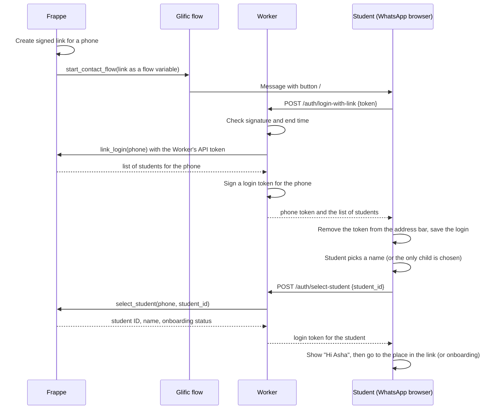
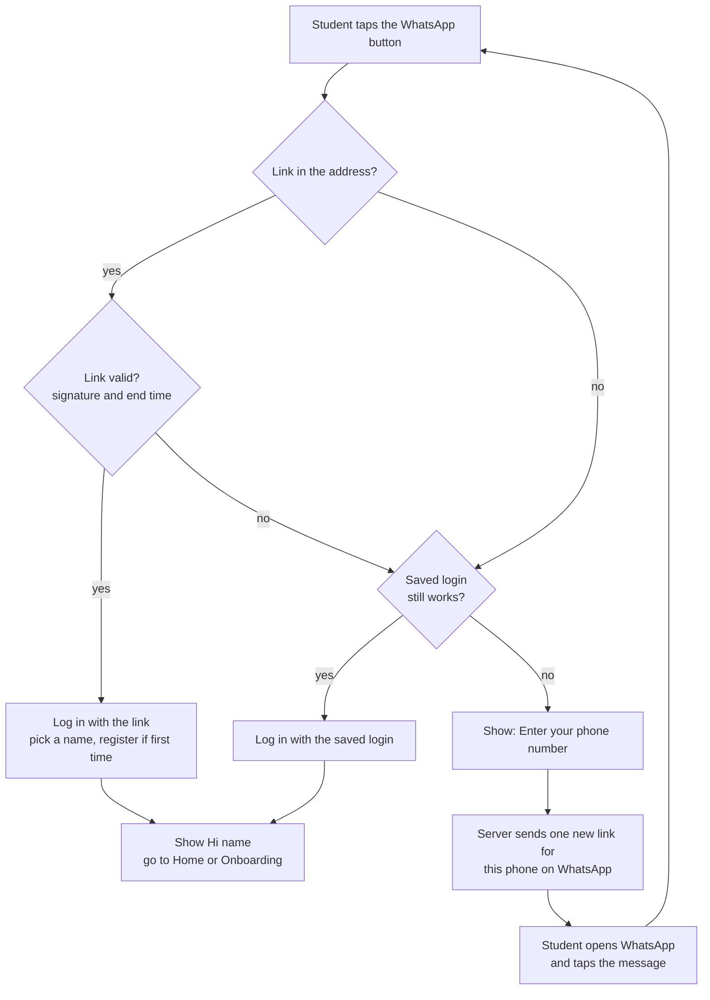
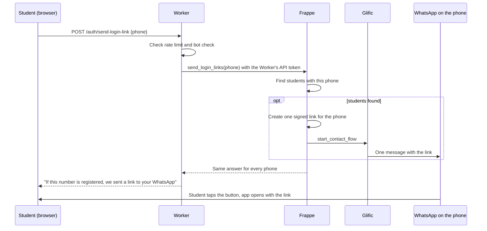

# WhatsApp Link Login (Draft Spec)

**Status:** draft for review. No code has been written yet.

**Update (2026-10-22):** version 1 now uses a link that carries the **phone**, and a **name picker** after login. This matches the "Who is learning" and "Switch profile" screens in the Figma. The first draft used one link for each student and no picker. See A3, A11 and the new risk 14.

**Update 2 (2026-10-22):** progress, submissions and feedback now follow the [v1 requirements](v1-requirements.md). The TAP team proposes the WhatsApp system's `ProgramEnrollment` as the single progress record, with no copy in `Tapapp Learner` (O-8, waiting for discussion and closure). Submissions go through the existing `save_submission`. `frappe_tap` is in production, so we change none of its existing logic without the client's approval. This changes "Registration", "Progress between WhatsApp and the app" and the open questions below.

**Codes used in these documents:** see [codes.md](codes.md).

## Context

Today, students use TAP through WhatsApp (with the Glific platform). We want to move students eventually to the TapApp web app and native app. The initial goals are to find gaps, to measure where students stop (drop-offs), and, finally, to stop using WhatsApp completely.

To make the move easy, we add a button to a WhatsApp message. When the student taps it, TapApp opens inside WhatsApp's own browser, and the student is **logged in automatically**. The student does not type a phone number or a password. The student is already in TAP's records, so the first tap needs no sign-up. (This is the plan if the client accepts `ProgramEnrollment` as the one progress record, O-8. The prototype instead created a `Tapapp Learner` on the first tap.)

For now, WhatsApp stays as the channel for **notifications**: reminders, escalations (extra nudges when a student is quiet), and notes that feedback is ready. Each of these messages carries a link that opens the web app. The lessons and the feedback are shown in the web app.

Because WhatsApp will go away later, the link is only a bridge. The design keeps the link creation in one function. A later version can send the link through another channel.

## Scope

- **Version 1 (this spec):** the web app, opened from a WhatsApp link. The link logs the phone in. There is **no PIN**. After login the student picks their name from the children of that phone (the "Who is learning" screen in the Figma). If the phone has one child, the app opens that child directly.
- **Version 2 (not in this spec):** a PIN to protect the name picker on shared phones, and the Android app. The teacher-created accounts and the school (shared device) login belong here too.

The design should not block version 2. For example, the login token should not assume that a link was used.

## Words used in this document

| Word | Meaning |
|---|---|
| Glific | The WhatsApp platform TAP uses to talk to students. |
| Template (HSM) | A WhatsApp message that WhatsApp approved in advance. Ours has a button that opens a web address. |
| Worker | Our small server (Cloudflare) between the app and Frappe. It checks tokens and limits requests. |
| Frappe | The main TAP server. It stores students, enrollments and progress. |
| Student ID | The ID of a student in the existing system. It looks like `ST00000123`. The `Student` record also has the phone and the Glific ID. |
| Learner ID | Prototype only. The ID of a `Tapapp Learner` (for example `TL00000123`). It goes away if `ProgramEnrollment` is the one progress record (O-8). |
| Glific ID | The ID of a contact in Glific. We believe there is one for each student. |
| Registration | Prototype only: creating a `Tapapp Learner` the first time. With `ProgramEnrollment` as the record, there is nothing to create (see "Registration"). |
| Token | A signed text that proves who the user is. |
| Signature (HMAC) | A secret code made from a message and a secret key. Only the servers that know the key can make it. If someone changes the message, the signature no longer fits. |
| Probe | A small test the app runs to find out if the browser keeps its saved data. |
| OTP | One-time password. A short code sent to a phone. |

## How the link works (short version)

1. Frappe creates a **signed link** for one phone. The link contains the phone and an end time. (A message about one child can carry a link for that student instead. See A11.)
2. Frappe asks Glific to send a WhatsApp message with the link.
3. The student taps the button. TapApp opens.
4. The **Worker** checks the signature and the end time.
5. The Worker asks Frappe for the students of that phone.
6. The Worker creates a login token for the phone and sends it to the app, with the list of students.
7. The student picks their name (or the app opens the only child). The Worker checks that the student belongs to the phone, and gives the app a login token for that student.
8. The student sees their home screen.

If someone changes the phone in the link, the signature does not fit, and the Worker refuses the link.

## Decisions already taken

| # | Decision |
|---|---|
| A1 | A valid link logs the student in. There is no password step. |
| A2 | The **Worker** checks the link signature. The app never decides if a link is valid. |
| A3 | A login link is for one **phone**. After login the app shows the children of that phone and the student picks their name (the Figma "Who is learning"). With one child, it opens that child directly. A message about one child (for example "feedback is ready") can carry a link for that student, which opens that child directly (see A11). |
| A4 | An expired or invalid link shows **no** student information. |
| A5 | If there is no valid link and no saved login, the app shows a screen to type the phone number. If students are registered with that phone, Frappe sends one new link for that phone on WhatsApp. The screen gives the same answer for every number. |
| A6 | **Design as if every visit from WhatsApp is a fresh browser launch.** We do not trust saved data to stay. |
| A7 | The **server** is the source of truth. The app sends progress to the server after each step. Saved data on the device is only a speed-up. |
| A8 | Lessons are shown in the web app, not in WhatsApp messages. WhatsApp sends notifications (reminders, escalations, "feedback is ready"), and each one carries a **fresh link**. The saved login still helps, because a student may open an old message. The phone-number screen (A5) is the way back in when there is no valid link and no saved login. |
| A9 | We do not use passwords or OTP codes for students. The WhatsApp link is the proof that the student owns the phone. |
| A10 | The Worker creates the login token (it signs it). Frappe already accepts tokens signed with the shared secret. |
| A11 | The link carries an ID with a **type** in front. A login link carries the **phone** (`ph:919876543210`). A link about one child can carry the student (`st:ST00000123`). Later, the link can carry another kind of ID without a new format. The phone is inside the signed text, so nobody can change it, but anyone who sees the link can read it. We accept this, because the link goes to that phone's owner. |
| A12 | A message about one child names the student ("Feedback for Asha is ready"). A login link for a phone does not name anyone. After login the app shows the name picker. With one child, the first screen says "Hi Asha" and has a "Not you?" button that opens the picker. |
| A13 | When a student is picked (or opened by an `st:` link), the Worker checks that the student belongs to the phone and has an active `ProgramEnrollment`. It creates no new progress record (see "Registration"). |
| A14 | We log events from the first day, so the client can measure drop-offs (see "Events to log"). |
| A15 | The link can say **where to go** after login (for example the feedback for one submission). The place is inside the signed text, so nobody can change it. The app accepts only places from a fixed list. |
| A16 | One Frappe function creates every link. All notification jobs (content, reminders, escalations, feedback) call it. |
| A17 | Each student has **one progress record**: the `ProgramEnrollment` (v1 requirements, O-8). Prototype `Tapapp Learner` rows hold no real data and are deleted before launch. If O-8 is not accepted, the old rule applies: one learner for each student, with a unique rule on the `student` field (or a lock in code). |

## Settings

These are proposed values. Please review them.

| # | Item | Proposed value |
|---|---|---|
| LS1 | How long a link works | 7 days. It only has to cover the first login and devices that lose saved data. Keep it as a Frappe setting, so it can change without a new release. |
| LS2 | Can a link be used more than once? | Yes, until it expires. WhatsApp can open a link in the background (a link preview) before the student does. A one-time link would be used up by that. |
| LS3 | How long the login lasts after using a link | 30 days with sliding refresh. See the explanation below. Keep it as a Frappe setting. |
| LS4 | Phone number format | One format everywhere: country code and number, no spaces and no `+` (for example `919876543210`). The primary phone is `Student.phone`. |
| LS5 | Limits on the phone-number screen | 1 request per minute and 3 per hour for each phone. 10 per hour for each internet address (IP). A bot check (for example Cloudflare Turnstile) before sending. |
| LS6 | Most links sent for one phone in one request | 1. A phone gets one link, however many children are linked to it. |

### More about LS3: login length and refresh

The server gives the app a token. The token has an end date. If the student keeps using the app, the server gives a new token before the old one ends. This is called **refresh**.

- **Today:** a token lasts 90 days. The server refreshes it when **less than 30 days** are left.
- **The rule must fit the token length.** If the threshold is as long as the token, the server refreshes on **every** request.
- **Our rule:** refresh only when **less than half** of the token's life is left. For a 30-day token, that is 15 days.
  - Days 0 to 15: no refresh.
  - Days 15 to 30: the next request gets a new 30-day token.
  - A student who does nothing for 30 days is logged out.
- **Code to change:** `REFRESH_THRESHOLD_SECONDS` in `worker/src/auth.js` (Worker) and `TOKEN_REFRESH_THRESHOLD_DAYS` in `tapapp_auth.py` (Frappe). The code should work out the threshold from each token's own length.
- **On devices that do not keep saved data,** the app cannot keep the token, so the length does not matter. These students need a link or the phone-number screen on each visit. They cost the most messages, so we log how often this happens.
- **Before launch:** with a 30-day login, we must be able to cancel tokens (known gap S8).

## The link

WhatsApp lets us put **one variable at the end** of a button web address. TapApp uses `#` in its web addresses, so the template address is:

```
https://<app-host>/#/l/
```

The variable `{{1}}` is one token:

```
<payload>.<signature>
payload   = base64url("v1|<type>|<id>|<exp>|<dest>|<kid>")
signature = base64url(HMAC-SHA256(secret[kid], "v1|<type>|<id>|<exp>|<dest>"))
```

- `<type>` is the type of the ID: `ph` (a phone number, for a login link) or `st` (a student ID, for a message about one child). `<id>` is the phone or the student ID.
- `exp` is the end time of the link (Unix time, in seconds). It is inside the signed text, so nobody can change it.
- `dest` is the place to open after login. Examples: `home`, `class`, `feedback:<submission_id>`. It is inside the signed text too. The app accepts only places from a fixed list, and only places inside the app. If `dest` is empty or unknown, the app opens `home`.
- `kid` is the key ID. It lets us change the secret key later without breaking all links.
- The secret key is not the same as the login-token secret. It is stored in two places: in Frappe (the `Secrets` doctype, for example `tapapp_link_secret`) and in the Worker (a Wrangler secret, `LINK_SECRET`). Frappe uses it to create links. The Worker uses it to check them.
- The Worker compares signatures in a way that does not leak timing information (constant-time compare).
- The part after `#` is not sent to the server. So the token does not appear in server logs.

## How Frappe trusts the Worker

The Worker checks the link, then asks Frappe for the student's data. If Frappe answered anyone who asked, a stranger could call it with any student ID.

Many existing Frappe endpoints that Glific calls are open (`allow_guest=True`) and have no secret check. We do **not** copy that pattern. See known gap S13.

We use Frappe's built-in API token for a service user:

- Create a Frappe user for the Worker, with its own role. Create an API key and secret for it.
- The Worker sends `Authorization: token <key>:<secret>` on these calls. (The app's own token travels in a different header, `X-Flutter-Authorization`.)
- The new methods (`link_login`, `send_login_links`) are normal `@frappe.whitelist()` methods, **not** `allow_guest`. They check the role with `frappe.only_for(...)`.
- Frappe stores the secret encrypted and does the check. We write no custom check code.
- The key and secret are Wrangler secrets in the Worker (`FRAPPE_API_KEY`, `FRAPPE_API_SECRET`). These names are already in the deployment notes.
- This also helps with known gap S3 for these methods.
- An IP allow-list for the Worker is not a good fix. Cloudflare Workers call from Cloudflare's shared address ranges, which other Workers use too. The API token is the real protection.
- To confirm: how `callBackend` in `routes.js` sets the `Authorization` header today.

## Registration

**Plan (if the client accepts `ProgramEnrollment` as the one record, O-8).** Students and their enrollments already exist in the WhatsApp system. TapApp creates no learner and no progress record. Both steps below only read data.

**Phone lookup.** The data holds both 10-digit and 12-digit phones, and `Student.phone` is not unique. The lookup must accept both forms (the existing code does, in `normalize_phone_number` in `api.py`). `Student.phone` has an index.

**Step 1: `link_login(phone)`, when the link is opened.**
1. Find the students with this phone (`Student.phone`) that have an active `ProgramEnrollment`. If there are none, refuse.
2. Find the phone's `Tapapp Auth` record. If there is none, create it from the phone. (This is a record in `tapapp`, not in `frappe_tap`.)
3. Return the list of students (student ID, first name, grade, course) and, for each, whether onboarding is finished. Cap the list (see risk 9).

**Step 2: `select_student(phone, student_id)`, when the student picks a name (or the app opens the only child, or an `st:` link is used).**
1. Check that the student belongs to this phone and has an active `ProgramEnrollment`.
2. Return the student ID, the name, and whether onboarding is finished.

Rules:
- Brothers and sisters share a phone. The first call creates the `Tapapp Auth` record. Each child's pick only returns that child.
- A link preview should not log anyone in. The token is after `#`, which is not sent to the server, and preview tools do not run the app. We should test this.

**If O-8 is not accepted** (the prototype model), `select_student` also gets or creates a `Tapapp Learner` and its profile row. That must be safe against a second tap or two taps at the same time (A17).

## Login token

The Worker signs the token with the shared token secret. It has the same claims as today (`phone`, `type: access`, `iat`, `exp`, `jti`), plus one new one: `sid` (student ID). If `Tapapp Learner` stays (O-8), there is also `lid` (learner ID). Frappe ignores claims it does not know, so it still accepts the token. Frappe still checks that `phone` matches the request. Later releases can move the checks from `phone` to `sid`, and then drop `phone`.

With a phone link, the Worker first gives the app a token that has only the phone. After the student picks a name (`select_student`), the Worker gives a new token with `sid`. Calls that are about one student (submissions, progress, feedback) are refused with the first token.

## What we assume about saved data on the device

Because of A6, the app must work when the device keeps nothing between visits.

- **Test, do not guess (the "probe").** On the first visit, the app saves a small note in the browser. On the next visit, the app checks if the note is still there.
  - If the note is there, the browser keeps our saved data. The app can use the saved login.
  - If the note is missing, the app does not trust saved data. It uses a link or the phone-number screen.
  - On the very first visit the app cannot know yet, so it assumes the data may be lost.
- **Do not use these browser checks.** `navigator.storage.persisted()` was `false` in every test. `navigator.storage.estimate()` showed zero usage even when data existed.
- **User agent is a hint only.** WhatsApp on Android adds `WA4A/<version>` to its user agent. We can use it as a hint. We should not depend on it alone.
- **Source tag.** When the app opens from a link, it records `src=wa` for the events. This tells us the visit came from the WhatsApp button.
- **One setting in the app.** `StoragePolicy.persistent` or `StoragePolicy.ephemeral`. If we later stop using the WhatsApp browser, the probe changes the setting by itself. No code change is needed.
- **The server comes first in both cases:**
  - Save each video, submission and quiz step to the server at once (R-40). The app keeps no steps on the phone to send later (O-16).
  - The weekly limit must be kept and checked on the server.
  - Saved AI reviews and saved TAP Buddy chat are optional. If they are lost, nothing should break.
  - Keep the login token only if the probe shows that saved data stays.

### Test results: WhatsApp browser

Tool used: `web/storage-probe.html`. This is a temporary page. Delete it after testing.

| Device | Time since first visit | localStorage | IndexedDB | Cookie | Cache API | sessionStorage | HTTP cache |
|---|---|---|---|---|---|---|---|
| Samsung SM-G781B (Galaxy S20 FE), Android 13, WhatsApp 2.26.38.73 | about 2.5 minutes (browser closed and reopened) | kept | kept | kept | kept | lost | used (0 bytes) |
| Same phone | about 4 minutes (WhatsApp force-closed) | kept | kept | kept | kept | lost | used (0 bytes) |
| Same phone | about 22 hours | kept | kept | kept | kept | lost | checked with server (300 bytes) |
| Samsung Galaxy A31, Android 12 | about 20 hours, four launches | kept | kept | not recorded | kept | not recorded | not recorded |

Other things we saw:

- WhatsApp adds `?fbclid=...` (about 150 characters) to the web address. The login token must go **after the `#`**, not in the part after `?`.
- The referrer is empty.
- `sessionStorage` is lost on every visit. Do not use it for the login.

**Not tested yet (no device):** iPhone, and other Android makers such as Xiaomi and Oppo. Both Android results are from Samsung. Treat iPhone and other makers as unknown and check them in the pilot.

**Also not tested:** more than one day, the `#/l/{{1}}` ending on the button, and the size of the real Flutter app on first load.

**Default for now:** use the probe. On the tested phones it says "persistent". Keep A6 and A7 to be safe.

## Flows

### Valid link



### What the app does when it opens

The app decides in this order:

1. **Valid link** → log in with it.
2. **Expired or missing link, and a saved login that still works** → log in with the saved login.
3. **Otherwise** → show the screen "Enter your phone number".

Other rules:
- A link with a **wrong signature** (not just expired) is treated as a missing link.
- A `ph:` link for the same phone as the saved login shows the name picker again, and keeps the saved data of each child.
- The server never shows names, profile counts, or "account exists" before login (A4).
- If an `st:` link is for a different student than the saved login, the app **switches** the saved login and the active profile to the new student. Nothing waits to be sent, because every step is saved to the server at once (R-40, O-16).
  - If the phone is the same (brothers and sisters), the app keeps the saved data of each child. It is stored for each student ID, so it does not mix. Do **not** call `clearAll`.
  - If the phone is different, the app calls `clearAll`.
- On every login by link, the app refreshes the learner state from the server. The saved state has no expiry, so it can be old (for example, progress made on another device or on WhatsApp). The server is always right.
- One login slot per browser: the token, the phone, the active profile and the language setting are single values. Only one student is logged in at a time.



### The phone-number screen

The student types the phone number. The server finds the students with this phone (`Student.phone`). It sends **one** message with a link for that phone (limit LS6). If a student is found but has no Glific ID (`Student.glific_id`), no message can be sent. The screen still gives the same answer, so the student is stuck. We log this case (see "Events to log") and the client must decide how these students get a link (for example, a staff-made link).

The screen always says: "If this number is registered, we sent a link to your WhatsApp." The text and the response time are the same for every number.



## Events to log (A14)

Log each event with the student ID (or learner ID), the time, and `src` where it makes sense. The client can then see where students stop.

Use the existing structured logging in Frappe (`emit` in `tap_lms/monitoring.py`). It writes JSON logs that go to Cloud Logging. Glific logs already go to BigQuery, and the two can be joined on `student_id` or `glific_id`. Log the student ID, **not** the phone number.

- Link not sent because the student has no Glific ID
- Link created, message sent, message delivered or failed (with the kind of message: login, content, reminder, escalation, feedback ready)
- Link opened (valid, expired, or wrong signature)
- Registration done (first time)
- Login by link, login by saved login
- Phone-number screen shown, link requested, request refused by a limit
- "Not you?" tapped
- First lesson started, first unit completed
- Probe result (saved data kept or not), and the device type from the user agent

## Progress between WhatsApp and the app

The client wants students to switch between WhatsApp and the app without losing progress. The client's rule says there is one progress record for all channels. The TAP team proposes `ProgramEnrollment` as that record (v1 requirements, O-8). The client has not answered yet.

Today there are two separate places for progress:
- **WhatsApp system:** `ProgramEnrollment` (a state machine driven by a job every minute), submissions, quizzes, and so on. Points, streaks and gems are copied to Glific contact fields.
- **TapApp:** `Tapapp Learner`, with its own XP, streak, gems, enrollments and weekly counters.

We compared the field lists and the main rules in the code (v1 requirements, section 9). The weekly limit and the level work differently in the WhatsApp system.

**Submissions and feedback.** The prototype sends text and images to an AI model (Groq) through the Worker. This will **not** be carried forward. TapApp will use the existing pipeline: `save_submission`, then plagiarism check, then AI feedback. WhatsApp will send a note that feedback is ready, with a link (A15). How the existing pipeline works today (from the system documentation):
- `save_submission` needs an **active `ProgramEnrollment`** for the student. So a student must be enrolled in the Summer Program state machine to submit work. The client confirmed that every app student is.
- The feedback step (the state change, the points and the WhatsApp message) runs only when the student has asked for the feedback (`send_feedback` is "yes"). Glific sets it with `ready_to_receive_feedback` when the student answers a prompt. The app has no prompt, so our server calls `ready_to_receive_feedback` once, about 12 hours after the work is sent (v1 requirements, R-80 and O-21). Who runs that 12-hour timer is open (O-21): a Worker cannot wait that long by itself. Without it, the points and the week change wait for the weekly delivery job and no WhatsApp message goes out. The feedback text and the audio link are read from `Submission` (`overall_feedback`, `audio_feedback_url`).
- Quizzes run on the server: `start_quiz` and `submit_answer` (one call per question). The server measures the time for each answer. The prototype app runs quizzes on the device. In the code the server also sends the correct answer to the client with each question, enforces no time limit and allows retakes (v1 requirements, O-24).

The existing calls cannot be changed without the client's approval, because they are in production. `save_submission` accepts calls that carry no key, and `get_submission_feedback` answers anyone who knows the submission id. So the Worker calls `save_submission` and `ready_to_receive_feedback` with its service key. New read-only methods in `tapapp` read the feedback and the valid or not valid result from `Submission`. See the v1 requirements: "Rules for our changes", O-17, O-21 and O-22.

### Decision

The client's rule says one progress record for all channels. The TAP team proposes `ProgramEnrollment` as that record, with no copy in `Tapapp Learner` (v1 requirements, O-8). The earlier idea "copy once, one side at a time" is dropped. You can find it in the git history.

## What must be built or changed

### Frappe (`tap_lms/tapapp/api/auth/`)

These methods live in `tapapp`. If the client accepts `ProgramEnrollment` as the single record, they only read `frappe_tap` data (students and enrollments) and write nothing in production tables.

| Method | Who can call it | Purpose |
|---|---|---|
| `make_webapp_link(id, dest)` (internal, not a web method; `id` is a phone or a student) | Called by Frappe code only | Creates the signed link (A16). The notification jobs call it (content delivery, reminders, escalations, feedback ready). It does not send anything. |
| `send_link_to_student(student, dest)` (internal, not a web method) | Called by Frappe code only (a job, an event, or `send_login_links`) | Calls `make_webapp_link`. Finds the Glific contact (`Student.glific_id`). Starts the Glific flow with `start_contact_flow`, passing the link and the name in `default_results`. A later version can change the channel here. |
| `link_login(phone)` | Only the Worker's service user (API token, role check) | Finds the students of the phone. Creates the phone's `Tapapp Auth` record if needed. Returns the list of students. |
| `select_student(phone, student_id)` | Only the Worker's service user (API token, role check) | Checks that the student belongs to the phone and has an active `ProgramEnrollment`. Returns the student ID, name and onboarding status. |
| `send_login_links(phone)` | Only the Worker's service user (API token, role check) | Finds students with this phone. If there are any, sends one link for the phone (LS6). Gives the same answer and takes the same time for every phone. Logs every send and every failure. |
| `check_phone`, `login_with_password`, `forgot_password_*`, `reset_password` | Anyone (guest) | Not used for students (A9). They are in `tapapp_auth.py`, so we own them. Lock or remove them so they cannot be called. This closes known gaps S1, S2 and S4. If teachers use passwords, keep that path separate. |

### Worker

- Add three routes in `routes.js`: `/auth/login-with-link` and `/auth/send-login-link` (both `auth: false`), and `/auth/select-student` (needs the phone token).
- `/auth/login-with-link`: check the link, call `link_login`, sign a token for the phone, return the token and the list of students. For an `st:` link, also call `select_student` and return the student token.
- `/auth/select-student`: check the phone token, call `select_student`, sign a token with `sid`, return it.
- `/auth/send-login-link`: bot check, then call `send_login_links`.
- Add a rate-limit group for `/auth/send-login-link` in `ratelimit.js` (LS5).
- For every call that is about a student (submissions, quizzes, progress), the Worker sets `student_id` from the login token (`sid`) and ignores any ID sent by the app. This stops a user from acting as another student. It also keeps wrong IDs out of the pipeline, where a bad ID can leave a stuck message in RabbitMQ.
- Add the secrets: `LINK_SECRET` (to check links), and `FRAPPE_API_KEY` and `FRAPPE_API_SECRET` (to call Frappe as the service user).
- Change the token refresh threshold (see LS3).

### Flutter app

- Add a route `/l/:token` in `lib/app/router.dart`. It must run **before** the login check.
- Add the "Enter your phone number" screen and the "we sent a link" message.
- After login with the link, call `history.replaceState` to remove the token from the address bar.
- Show the name picker (the Figma "Who is learning" screen). With one child, go straight to that child's home screen (or onboarding) and show "Hi <name>" with a "Not you?" button that opens the picker. Keep "Switch profile" in Me.
- Add the new texts in all languages (en, hi, mr, kn, pa).
- Add the storage probe and the `StoragePolicy` setting.
- Send the events listed above.

### Glific

**Approval.** Everything in this section changes Glific flows or WhatsApp templates that students receive. Adding links to the existing reminder, escalation and content messages also changes production behavior (the `pe_dispatcher` handlers and `feedback_consumer`). The client must approve these before we build them (v1 requirements, "Rules for our changes").

- One flow that Frappe starts for one contact. It reads the link (and the student's name, for a message about one child) from the flow variables and sends the template message. Frappe uses this same flow for the first message to a student and for the phone-number screen.
- Glific does not call Frappe for this feature.
- Templates with the name in the text and a dynamic-address button. WhatsApp must approve **each template separately**, so we need one for each kind of message that carries a link:

  | Kind of message | New template with a link button? |
  |---|---|
  | Login link (first message and the phone-number screen) | Yes, a new one |
  | "Feedback is ready" | Yes. Today's feedback message has no app link. |
  | Reminder | Yes, if we add a link to today's reminder |
  | Escalation (an extra nudge when a student is quiet) | Yes, if we add a link to today's message |
  | "Submission pending" nudge (v1 requirements, R-66) | Yes, a new one |

  `parent_call` escalations are phone calls and carry no link. We believe a button with the app link needs a new template, not an edit of an approved one. Please check this with whoever manages Glific. Send the templates for approval early, because WhatsApp can take time or refuse.
- For messages sent to a whole group, the link is different for each student. Two ways: Frappe starts a flow for each student, or Frappe writes the link into a Glific contact field (for example `webapp_link`) and the group flow uses it. The second way matches how Frappe already copies points and streaks into contact fields. At large size (about 100,000 students) the first way needs a queue and batches. Glific's limits have not been checked. A link in a contact field must be refreshed before it expires (LS1).

## Open questions

| # | Question |
|---|---|
| Q1 | Closed here. The question is now O-8 in the v1 requirements. |
| Q2 | Which `Student` fields are copied into `Tapapp Learner` at registration (name, grade, school, language, district, state, and so on)? Only needed if `Tapapp Learner` stays (see O-8). |
| Q3 | Does Glific allow two contacts with the same phone number? We believed one Glific ID belongs to one student. The code suggests that brothers and sisters share one Glific ID, so one contact for the phone (`add_pe_glific_id_unique_index.py` says so). Please confirm. |
| Q4 | Can a Glific template put a flow variable (the link) into its button address, and a second variable (the name) in the text? Our test flow suggests yes for the link. |
| Q5 | Where will the Frappe `tapapp` code live? The plan is `DalgoT4D/frappe_tap`. |
| Q6 | Who creates the old-system records (`Student`) for students who join later without WhatsApp? |
| Q7 | Do the school or shared-device flows (a teacher's phone with a class roster and a password) stay next to the parent flow? The code has `teacher`, `admin_code`, roster and bulk-update parts. If yes, the phone-number screen must apply only to parent phones. |
| Q8 | Answered: the client confirmed that every app student has an active `ProgramEnrollment`, because the app shares the same flow and logic as WhatsApp. |
| Q9 | Feedback and notifications: what exactly is sent, and when? The plan is a WhatsApp note with a link. The existing feedback flow in Glific must carry the link, and our server must call `ready_to_receive_feedback` once, about 12 hours after the work is sent. Both need the client's approval (v1 requirements, O-21). |
| Q10 | Closed here. TAP Buddy (the prototype's chat helper) and Ask TAP are now O-19 in the v1 requirements. |
| Q11 | The name picker lists the students found with `Student.phone`. Are there students whose own record has a different phone (for example only a parent's phone in another field)? How many students can share one phone? The code accepts 10-digit and 12-digit phones and `phone` is not unique, so the data probably holds both forms. |

## Risks and things to test first

1. **Browser storage.** A6 says assume nothing is kept. Still, test on more Android phones to learn what is kept (iPhone is not planned for year one, so check it only if a pilot student uses one), and measure how much the app downloads on first load (known gap GP3).
2. **Deep link with `#`.** Check that `/#/l/<token>` reaches the app's router inside the WhatsApp browser, through Firebase hosting.
3. **Shared links.** Anyone who has a valid link can log in until it expires. We accept this in A1 and limit it with LS1.
   - A test showed that the template message **cannot be forwarded**. The only way to share is: "Open in browser" in the WhatsApp menu, copy the address from Chrome, and paste it into a message. This takes several deliberate steps.
   - Still to check: the real production template behaves the same, and the button has no "copy link" option.
4. **"Open in browser" path.** The token stays in Chrome's address bar. It may also stay in Chrome history, and in synced history if the user is signed in to Chrome.
   - `history.replaceState` clears the address bar after login. We have **not** tested if Chrome history keeps the original address.
   - Also test that login by link works in Chrome, which starts with empty saved data.
5. **Cost and abuse.** WhatsApp bills every template message. On the phone-number screen, anyone can type any number, so a stranger could trigger many messages to parents. A phone gets one link, however many children it has. The limits, the cap (LS6) and the bot check (LS5) are required.
6. **Delivery.** If WhatsApp cannot deliver the message, the student sees nothing. Log delivery failures in Frappe. Check with the client if free-form messages within 24 hours of the student's last message are free for the Glific plan. We have not verified this.
7. **Long sessions on shared phones.** A 30-day login on a family phone stays open for anyone who picks it up. Add a visible "Log out" and the ability to cancel tokens (S8) before launch.
8. **Two systems at the same time.** Until the progress question (O-8) is decided, a student who uses both WhatsApp and the app can see different progress in each.
9. **Teacher and class phones.** A teacher's phone may have a roster of up to 200 students. With a phone link, the name picker could list up to 200 children. Cap the list, or show it only for parent phones. Decide Q7 first.
10. **Many messages with links.** Notifications will send a link in each message. At large size the cost and the load on Glific grow. See the Glific section.
11. **Secrets and the encryption key.** Frappe encrypts stored secrets (such as `tapapp_jwt_secret`, the future `tapapp_link_secret` and API secrets) with the site's encryption key. If the site is restored on a new server without that key, the secrets become unreadable and calls fail silently (see `docs/server_setup.md`, section 7a). Back up the key. If a secret is lost, all links and tokens stop working. The `kid` field lets us move to a new key.
12. **Two children on one device.** Saved data is stored for each student, but the login, the active profile and the language are single values. Test: child A, then child B, then child A again. Check that A's state is refreshed from the server, that nothing of B shows for A, and that the language is right for each child. Check if the language is a setting of the child or of the browser.
13. **Student lookup bugs.** The lookup must return only students of the phone that have an active `ProgramEnrollment`. Test it with brothers and sisters, students with no `glific_id`, and phones in both 10-digit and 12-digit form. If `Tapapp Learner` stays (O-8), also test "get or create" with double taps: a wrong one can make two learners for one student. The setup guide lists `SerializationFailure: could not serialize access` errors from concurrent writes (for example with `pe_dispatcher`). Registration must catch this error and retry.
14. **A phone link shows the siblings.** Whoever holds the link can see and pick any child of that phone, with no PIN. For brothers and sisters this may be fine. For a shared phone with unrelated children it is not. The PIN (version 2) closes this. Decide with the client (see O-6 in the requirements). The list must show only first names and grade, and be capped.

## Test plan (outline)

- **Worker:** valid, expired, changed and wrong-key links. A changed student ID or end time. Token claims. Tests for the new routes and the rate-limit group.
- **Frappe:** `link_login` with and without the Worker key. First registration and repeat registration. Brothers and sisters on one phone. Same answer and similar time for known and unknown phones in `send_login_links`.
- **Flutter:** router tests for the link route, the saved-login fallback, and the phone-number screen. Add them to the existing tests in `test/`.
- **Local test setup:** the Frappe repo has a local Docker setup (`docker-compose.local.yml`) with a Glific stub, so `start_contact_flow` can be tested without sending real messages.
- **Manual:** the full path in WhatsApp on Android phones from several makers. Use one iPhone only as a quick check.

## Proposed order of work

1. Answer the open questions that block work: Q2, Q3, Q4 and Q5. Confirm the settings LS1 to LS6.
2. Change the app to save each step to the server at once, and to read the weekly limit from the server (R-40, R-39).
3. Worker: link check, token signing, new routes, rate-limit group.
4. Frappe: signing functions, `send_link_to_student`, `link_login`, `send_login_links`, and tests. (Wait until the intern's work is merged.)
5. Flutter: link route, "Hi name" screen, phone-number screen, events.
6. At the same time: test the WhatsApp browser with a throw-away link (other Android makers, and one iPhone as a quick check).
7. Glific: the flow and the template.
8. Lock or remove the password and OTP methods for students. See [known gaps](known-gaps.md), items S1, S2 and S4.
9. Get the client's answer on the single progress record (O-8).
